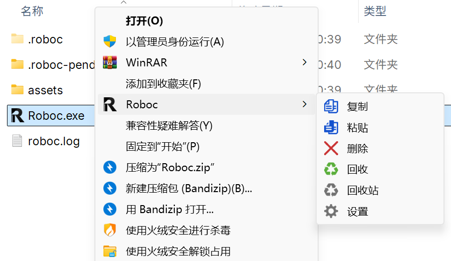
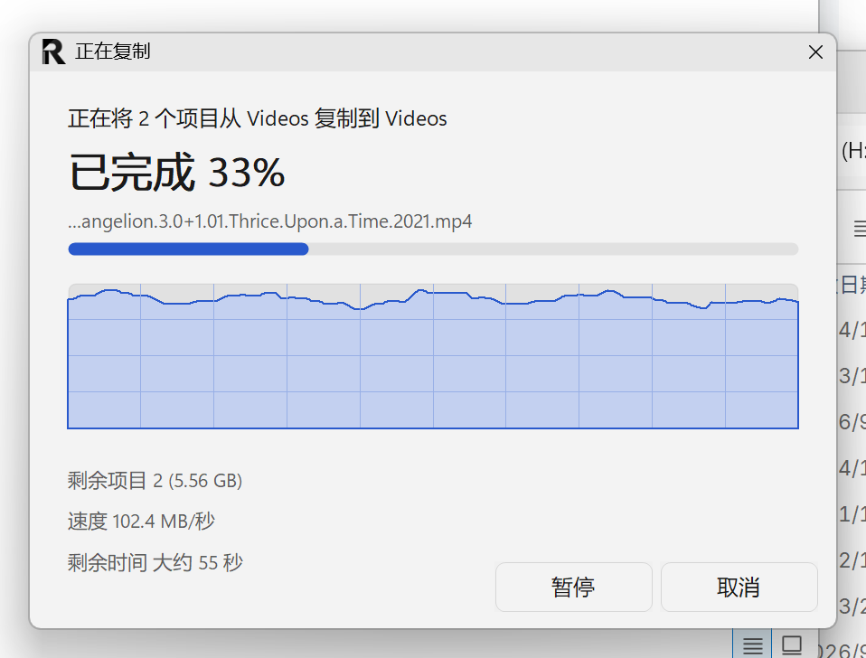
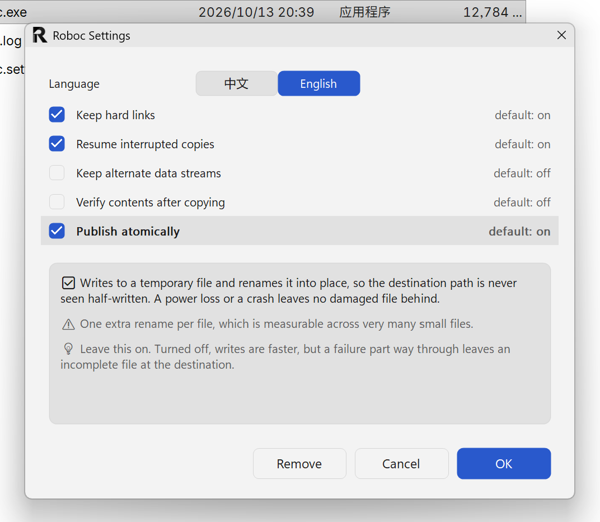

<p align="center">
  <picture>
    <source media="(prefers-color-scheme: dark)" srcset="assets/icons/Roboc-dark.png">
    
  </picture>
  &nbsp;&nbsp;
  
  &nbsp;&nbsp;
  
  &nbsp;&nbsp;
  
</p>

<h1 align="center">Roboc</h1>

<p align="center">
  <strong>中文</strong> · <a href="README.md">English</a>
</p>

<p align="center">
  <strong>一个便携的 Windows 复制 / 删除工具</strong><br>
  深度集成资源管理器右键菜单
</p>

**为海量小文件而生。** 原生资源管理器复制几万个小文件时会卡在进度条上；Roboc 用多线程、块克隆与原子发布把同一件事做到接近磁盘上限。

**便携绿色。** 解压即用，双击注册菜单；不想要了，设置里点一次卸载，再删掉文件夹——**不留任何痕迹**。

---

## 快速开始

```
1. 解压到任意文件夹
2. 双击 Roboc.exe
        ↓
   自动注册右键菜单，弹出「Roboc 已就绪」
```

**不需要安装，不需要管理员权限。**

之后在资源管理器里选中文件或文件夹，右键即可看到：

| 右键菜单 | 复制进度 | 设置窗口 |
|---|---|---|
|  |  |  |

<p align="center">
  <em>六项菜单 · 速率曲线与剩余时间 · 每个开关标明收益与代价</em>
</p>

| 菜单项 | 作用 |
|---|---|
| **Roboc 复制** | 放入 Roboc 剪贴板 |
| **Roboc 粘贴** | 粘贴到当前目录（执行过复制后才出现） |
| **Roboc 删除** | 彻底删除，不进任何回收站 |
| **Roboc 回收** | 移入 `<卷>:\Roboc_bin\` |
| **Roboc 回收站** | 打开回收站目录 |
| **Roboc 设置** | 开关各项功能；**卸载也在这里** |

---

## 特性

### 默认启用

| 特性 | 说明 |
|---|---|
| **多线程复制** | 4–16 线程，按 CPU 核心数自动决定 |
| **块克隆** | 同卷 NTFS/ReFS 上服务端复制，近乎瞬时 |
| **硬链接保留** | 同一文件的多个名字在目标侧仍是链接，不展开成副本 |
| **重解析点重建** | 符号链接、junction 在目标侧重建为链接 |
| **断点续传** | 中断后重新执行同样的复制即可继续 |
| **原子发布** | 目标路径**永不被观察到半成品** |
| **进度窗** | 速率曲线、剩余时间、可暂停可取消 |

### 可选（默认关闭）

| 开关 | 代价 | 什么时候开 |
|---|---|---|
| **保留数据流（`--ads`）** | +3.8% ~ 7.4% 吞吐 | 备份归档、搬移下载文件——否则"来自 Internet"标记会静默消失 |
| **复制后校验（`--verify`）** | +54% 耗时 | 移动硬盘、U 盘、网络位置，或怀疑硬件有问题 |

**两项都在设置窗口里，各写明收益、代价与默认值。**

---

## 性能

实测（601 个文件 / 764 MB，三次取中位数）：

| 操作 | 结果 |
|---|---|
| **海量小文件复制** | 与 `robocopy /MT:32` 最好成绩持平，**稳定性显著更好**（自身波动 7% vs 114%） |
| **删除** | 比 PowerShell `Remove-Item` **快 2–3 倍**，比 `cmd rd` 快约 2 倍 |

**大文件为什么比 robocopy 慢？** 因为它**在等数据真正落盘**，而 robocopy 写进缓存就返回。实测本机卷的持续写入速度是 **967 MB/s**，Roboc 跑到 **831–1034 MB/s**（物理极限的 86–107%），而 robocopy 自报 **11,100 MB/s**——超过该卷物理能力 11 倍。

**这个等待是断点续传正确性的要求**：日志不得声称拥有断电后可能丢失的字节。

---

## 文档

| 文档 | 面向 |
|---|---|
| [使用说明](docs/使用说明.md) | **用户**——全部特性与开关、代价、常见问题 |
| [开发者文档](docs/开发者文档.md) | **维护者**——架构、设计决策、维护规则、视觉规范、性能数据 |
| [User Guide](docs/User%20Guide.md) · [Developer Guide](docs/Developer%20Guide.md) | 上述两份文档的英文版 |

---

## 从源码构建

**要求**：.NET 10 SDK、Windows 11。

```powershell
powershell -ExecutionPolicy Bypass -File build.ps1
```

产物在 `artifacts/portable/`，随后自动运行 `--selftest`（23 项）。

**构建脚本会自动设置完整性标签**——DSH 等工具链派生的进程运行在 Low 完整性级别，而 Low IL 进程无法写入 `HKCU`，不打标签会导致所有注册表写入被拒。

---

## 仓库结构

```
src/Roboc.App/           CLI、进度窗、弹窗、设置窗口
src/Roboc.Core/          复制引擎、删除引擎、回收站、Shell 集成、互操作
tools/Roboc.CorpusGen/   基准语料生成器
assets/icons/            菜单图标（构建时复制到产物）
scripts/                 基准与检查脚本
docs/                    文档
```

---

## 已知限制

| 项 | 状态 |
|---|---|
| 加密文件（EFS） | 未专门支持 |
| 稀疏文件 | 未专门支持 |
| 硬链接数量 | 超过 100 万条后按副本处理并报告 |

---

## 设计原则

**接受一个参数却什么都不做，比拒绝它更糟。**

拒绝只花一秒钟，**虚假的保证可能让你丢掉它本该保护的数据**。所以能做到但默认不做的（`--ads`、`--verify`）会明确说明代价；做不到的会直接拒绝执行。

**破坏性操作绝不在不确定的输入上执行。** 删除有三道防线（驱动器相对路径、卷根、程序自身目录），**它们来自一次真实事故**。

---

## 许可与商标

**代码**：[Apache License 2.0](LICENSE) —— 可自由使用、修改、分发，**包括商业用途**。

**名称**：「Roboc」用于标识本项目的原始作品与官方发行版。**许可证第 6 条不授予商标使用权**，所以：

- ✅ 可以用这份代码做任何事，包括打包出售，并说明它基于 Roboc
- ❌ 不能把修改版或再发行版当作**官方 Roboc**，也不能用这个名字暗示原作者为其背书

**官方渠道**：本程序的唯一官方来源是 [GitHub 仓库](https://github.com/Neus117/Roboc)。

**请只从上述官方渠道获取。** 本许可证允许任何人使用、修改甚至转售这份代码，所以**其他渠道出现的同名或改名的程序，都不是本作者发布的**。对第三方分发，作者不提供支持，也无法对其安全性、完整性或行为负责。

> 如果你不确定手头的程序是否来自官方渠道，请以本仓库源码自行构建。

详见 [NOTICE](NOTICE)。
